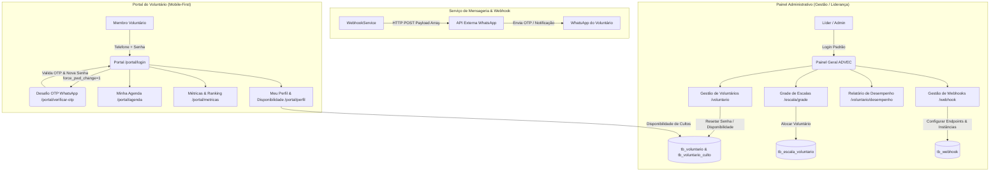
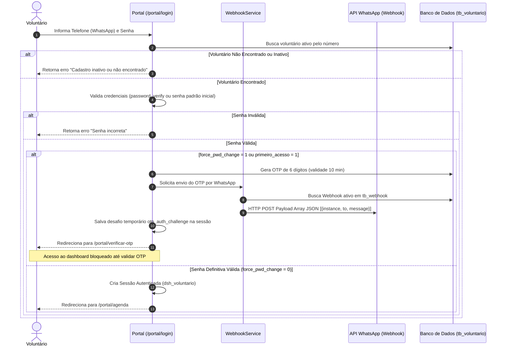
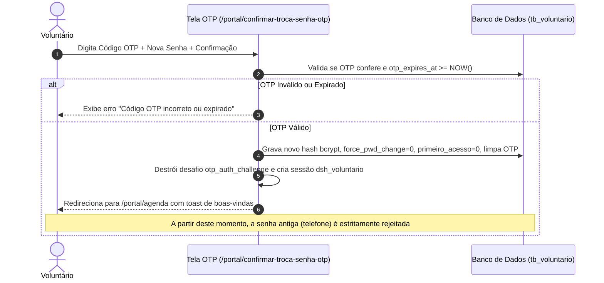
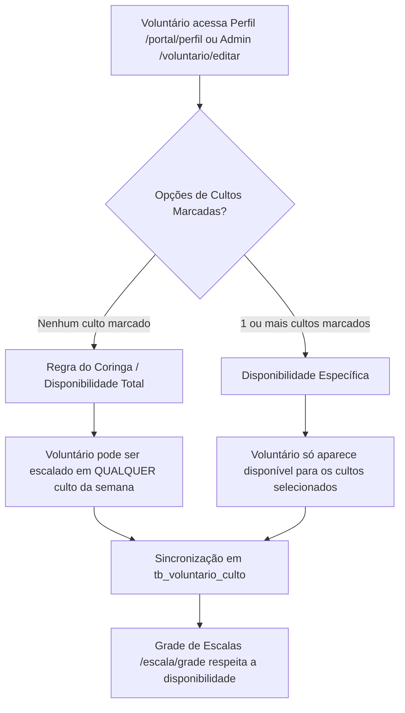

# Documentação do Portal do Voluntário, Segurança OTP & Gestão de Webhooks
**ADVEC Gestão - Sistema de Escalas, Engajamento e Segurança**

---

## 📌 1. Visão Geral do Sistema

Este documento descreve a arquitetura, fluxos operacionais, regras de negócio e estrutura de dados implementadas para o **Portal do Voluntário**, o **Módulo de Gestão de Webhooks**, a **Esteira de Segurança de Senha via OTP (WhatsApp)** e o **Módulo de Disponibilidade de Cultos (N:N)**.

O sistema opera em duas camadas integradas:
1. **Painel Administrativo (Liderança / Gestão)**:
   - Gestão de voluntários e líderes;
   - Cadastro e vinculação de sub-áreas de atuação;
   - Grade de cultos e alocação com validação de limites e conflitos;
   - Gestão de Webhooks para mensageria WhatsApp (Evolution API, Z-API, etc.);
   - Relatórios de desempenho, assiduidade e auditoria de cancelamentos.
2. **Portal Exclusivo do Voluntário (Mobile-First)**:
   - Autenticação e esteira de segurança com validação via OTP no WhatsApp;
   - Agenda mensal de escalas com confirmação/recusa rápida;
   - Configuração de disponibilidade para servir em cultos específicos ou geral (coringa);
   - Gamificação e ranking de fidelidade;
   - Edição de perfil e atualização segura de dados cadastrais e foto.

---

## 📐 2. Fluxos do Sistema (Diagramas Mermaid)

### A. Arquitetura Geral e Perfis de Acesso



---

### B. Fluxo de Autenticação com Esteira de Segurança OTP (WhatsApp)



---

### C. Fluxo de Confirmação de OTP e Redefinição de Senha



---

### D. Fluxo de Disponibilidade de Cultos para Servir (N:N)



---

## 🗂️ 3. Módulos e Funcionalidades Entregues

### 1. Gestão de Webhooks (Painel Administrativo)
- **Cadastro e Listagem (`/webhook`)**: Gestão de URLs de webhook e instâncias padrão de WhatsApp.
- **Teste em Tempo Real (`/webhook/testar`)**: Modal AJAX para envio de mensagem de teste para qualquer número de homologação.
- **`WebhookService`**:
  - Higienização e padronização automática com DDI 55 (ex: `5511999999999`).
  - Formatação obrigatória de payload HTTP POST em **Lista/Array JSON**:
    ```json
    [
      {
        "instance": "instancia_padrao_do_banco",
        "to": "5511999999999",
        "message": "Seu código de verificação é: 123456"
      }
    ]
    ```

### 2. Autenticação & Esteira de Segurança OTP
- **Interceptação de Primeiro Acesso e Reset**: Usuários com `force_pwd_change = 1` são obrigados a validar a posse do WhatsApp via OTP antes de acessar o sistema.
- **Reenvio de OTP com Timer**: Interface com contador regressivo de 60 segundos para evitar abusos de requisições de mensagens.
- **Bloqueio Estrito de Senha Padrão**: Após a definição da nova senha, o sistema rejeita o uso do número de telefone como senha.

### 3. Disponibilidade de Cultos (N:N)
- **Tabela Relacional `tb_voluntario_culto`**: Vincula voluntários a múltiplos `tb_culto_padrao`.
- **Regra do Coringa**: Deixar todos os cultos desmarcados representa disponibilidade total em qualquer dia/horário.

### 4. Portal do Voluntário & Perfil
- **Agenda Interativa (`/portal/agenda`)**: Ações rápidas de confirmação ou recusa com modal obrigatório de justificativa.
- **Métricas & Ranking (`/portal/metricas`)**: Gamificação baseada em assiduidade, presenças e confirmações.
- **Meu Perfil (`/portal/perfil`)**: Upload seguro de fotos em `FCPATH` com preview visual, edição de dados e redes sociais.

---

## 💻 4. Tabela de Rotas e Endpoints

| Método | Rota | Descrição | Filtro / Proteção |
| :--- | :--- | :--- | :--- |
| `GET/POST` | `/portal/login` | Tela e processamento de login do voluntário | Público |
| `GET` | `/portal/logout` | Encerra a sessão do voluntário | Público |
| `GET` | `/portal/verificar-otp` | Tela de desafio de código OTP e nova senha | Desafio OTP |
| `POST` | `/portal/confirmar-troca-senha-otp` | Valida OTP e conclui alteração da senha | Desafio OTP |
| `POST` | `/portal/reenviar-otp` | Dispara novo código OTP por WhatsApp | Desafio OTP |
| `GET` | `/portal/agenda` | Agenda mensal do voluntário | `auth_voluntario` |
| `POST` | `/portal/confirmarEscala` | Confirmação de presença em um culto | `auth_voluntario` |
| `POST` | `/portal/recusarEscala` | Recusa de presença com justificativa | `auth_voluntario` |
| `GET` | `/portal/metricas` | Tela de Métricas, Assiduidade e Ranking | `auth_voluntario` |
| `GET` | `/portal/perfil` | Formulário de perfil e disponibilidade | `auth_voluntario` |
| `POST` | `/portal/salvarPerfil` | Salva dados, foto e disponibilidade de cultos | `auth_voluntario` |
| `POST` | `/portal/alterarSenha` | Altera a senha no painel de perfil | `auth_voluntario` |
| `GET` | `/webhook` | Listagem de Webhooks cadastrados | `auth` (Admin) |
| `GET/POST` | `/webhook/novo` / `editar/(:num)` | Cadastro e edição de webhook | `auth` (Admin) |
| `POST` | `/webhook/salvar` | Salva configurações do webhook | `auth` (Admin) |
| `POST` | `/webhook/testar` | Teste de disparo de webhook via AJAX | `auth` (Admin) |
| `GET` | `/voluntario/desempenho` | Relatório de Desempenho e Cancelamentos | `auth` (Admin) |
| `GET` | `/voluntario/ranking` | Painel de Ranking de Voluntários (Visão Departamental e Multi-Departamento) | `auth` (Líder/Admin) |
| `POST` | `/voluntario/resetSenha` | Redefine senha do voluntário e ativa OTP | `auth` (Admin) |
| `GET` | `/voluntario/verificarTelefone` | Verifica existência global de voluntário por telefone | `auth` (Líder/Admin) |
| `POST` | `/voluntario/vincularRapido` | Vincula voluntário existente à sub-área do departamento | `auth` (Líder/Admin) |
| `GET` | `/voluntario/getSubareasPorDepartamento/(:num)` | Retorna sub-áreas ativas do departamento | `auth` (Líder/Admin) |
| `GET` | `/agenda/grade` | Grade mensal de cultos da congregação com filtros e meses anteriores | `auth` |
| `POST` | `/agenda/gerarGradeMes` | Geração automática da grade de cultos a partir dos modelos padrão | `auth` |
| `GET` | `/cultopadrao` | Listagem de cultos padrão e eventos avulsos cadastrados | `auth` |
| `GET/POST` | `/cultopadrao/novo` / `editar/(:num)` | Cadastro e edição de culto padrão ou evento avulso em data específica | `auth` |
| `POST` | `/cultopadrao/salvar` | Persistência de modelo de culto / evento avulso | `auth` |
| `GET` | `/dashboard` | Painel inicial com suporte à view padrão de boas-vindas | `auth` |
| `GET` | `/resource` | Listagem e gestão da Resource Library (Materiais e Coleções) | `auth_sysadm` (SysAdm) |
| `GET/POST` | `/resource/novo` / `editar/(:num)` | Cadastro e edição de material avulso com auto-parsing | `auth_sysadm` (SysAdm) |
| `GET/POST` | `/resource/novaColecao` / `editarColecao/(:num)` | Gestão de coleções e playlists com drag-and-drop | `auth_sysadm` (SysAdm) |
| `GET` | `/resource/autoParseUrl` | Auto-Parser de links do YouTube, Spotify, Drive e PDFs | `auth_sysadm` (SysAdm) |
| `GET` | `/resource/getRecursosEscala` | Retorna materiais anexados a um culto e departamento | `auth_sysadm` / `auth` |
| `POST` | `/resource/anexarNaEscala` | Anexa materiais avulsos ou coleção desmembrada na escala | `auth_sysadm` / `auth` |
| `POST` | `/resource/removerDaEscala` | Desanexa material de um culto específico | `auth_sysadm` / `auth` |
| `GET/POST` | `/api-client` | Painel de Gestão de Aplicações de API, Credenciais e Swagger Hub | `auth` (SysAdm) |
| `POST` | `/api-client/salvar` | Cria nova credencial de aplicação de API | `auth` (SysAdm) |
| `POST` | `/api-client/rotacionarSecret` | Rotaciona secret e invalida credenciais antigas | `auth` (SysAdm) |
| `POST` | `/api-client/toggleStatus` | Ativa ou desativa o acesso de uma aplicação | `auth` (SysAdm) |
| `POST` | `/api/v1/auth/token` | Emissão de token JWT via `client_id` e `client_secret` | `api_rate_limit` (10 req/min) |
| `GET` | `/api/v1/escalas/lembretes-pendentes` | Consulta de voluntários com escalas pendentes futuras | `jwt_api` + `api_rate_limit` (60 req/min) |
| `POST` | `/api/v1/escalas/marcar-lembrete` | Confirmação em lote de lembretes enviados | `jwt_api` + `api_rate_limit` (60 req/min) |
| `GET` | `/api/v1/docs` | Interface Swagger UI para testes interativos dos endpoints | Público |
| `GET` | `/api/v1/openapi.json` | Especificação OpenAPI 3.0 dinâmica baseada no `$baseURL` | Público |

---

### 5. Controle de Acesso Departamental para Gestores & Líderes
- **Tabela Relacional `tb_departamento_gestor`**: Associa os usuários do sistema (`tb_sys_usuario`) aos departamentos que eles gerenciam.
- **Filtro Estrito por Usuário Logado**:
  - Usuários líderes/gestores visualizam apenas voluntários e escalas dos departamentos atribuídos ao seu usuário.
  - No formulário de voluntários, sub-áreas de departamentos não gerenciados são exibidas desabilitadas (com cadeado e tooltip explicativo), preservando integridade das demais áreas do voluntário.
- **Gestão de Líderes no Cadastro de Departamento**:
  - No formulário de departamento (`/departamento/novo` e `/departamento/editar`), é possível selecionar diretamente quais usuários do sistema gerenciam a área.
- **Verificação Global de Telefone e Vinculação Rápida**:
  - Ao digitar o telefone no cadastro de novo voluntário, o sistema detecta se ele já serve em outro departamento e abre um modal rápido para adicioná-lo à equipe sem duplicar o cadastro principal.

### 6. View Padrão de Boas-Vindas (`_main/boas_vindas`)
- Tela inicial moderna e clean para recepção de todos os perfis de usuários.
- Saudação dinâmica (*Bom dia / Boa tarde / Boa noite*), cards de atalhos rápidos com base nas permissões do perfil, orientações gerais e suporte ao tema Dark/Light.

### 7. Biblioteca (Materiais de Apoio & Repertórios/Coleções)
- **Controle de Acesso RBAC & Departamental**:
  - Acesso ao módulo governado por permissões de perfil (`SessionModel` -> `$data['sys_action']->read/create/update/delete`).
  - No filtro e nas listagens de materiais e coleções, a opção **🌐 Global (Todos)** está sempre disponível para consulta e associação geral.
  - Os demais departamentos listados no combo e acessíveis para cadastro/gestão restringem-se estritamente aos departamentos autorizados ao usuário logado via `tb_departamento_gestor` (seguindo o mesmo conceito do módulo de voluntários).
- **Auto-Parsing Inteligente**:
  - YouTube: Extração de ID, geração de thumbnail (`hqdefault.jpg`) e URL segura de embed.
  - Spotify: Detecção de faixas/álbuns/playlists e geração de player nativo do Spotify.
  - Google Drive e PDFs: Modo de pré-visualização inline e visualizadores integrados.
- **Coleções (Playlists) & Desmembramento em Escalas por Sub-área**:
  - Permite criar coleções e ordenar os materiais via Drag-and-Drop.
  - Ao anexar materiais ou coleções a um culto, o líder pode definir o destino: **🌐 Geral (Todas as Sub-áreas)** ou uma **Sub-área específica** (ex: Louvor - Backing Vocal).
  - Na grade mensal de escalas (`/escala/grade`), os cultos com materiais exibem um indicador/badge com a contagem exata de materiais anexados.
- **Visão do Voluntário (Mobile-First)**:
  - Na tela de Agenda (`/portal/agenda`), o voluntário visualiza exclusivamente os materiais gerais do departamento somados aos materiais direcionados à sua sub-área de atuação escalada, com reprodutor nativo em modal interativo.

### 8. Experiência Visual do Portal, Tema & Redes Sociais
- **Seletor de Tema (Dark / Light / Automático)**:
  - Toggle de tema no menu superior ([`_nav.php`](file:///Users/elpidio.junior/Documents/_projetos/advec/ci-advec/app/Views/portal_voluntario/_nav.php)) ao lado do avatar do usuário.
  - Script anti-flicker no `<head>` de todas as páginas do portal para renderização imediata da preferência salva em `localStorage` ou detecção nativa do sistema operacional (`prefers-color-scheme`).
  - Paleta equilibrada com alto contraste para evitar sobreposição de elementos escuros.
- **Redes Sociais & UX Mac Dock ([`perfil.php`](file:///Users/elpidio.junior/Documents/_projetos/advec/ci-advec/app/Views/portal_voluntario/perfil.php))**:
  - Micro-compositor expansível `+` para cadastro instantâneo de redes sociais apenas digitando o *handle/nickname* ou URL completa (com resolução automática de URLs raiz para Instagram, LinkedIn, TikTok, YouTube, Facebook, X/Twitter, Threads, GitHub, etc.).
  - Lista visual inspirada na Dock do macOS com efeito suave de levitação (`hover lift`) e links externos com segurança `rel="noopener noreferrer"`.
  - Agrupamento das sub-áreas de atuação por departamento com espaçamento simétrico (`py-3`) e cores institucionais.
- **Métricas, Assiduidade & Comparativo com Mês Anterior ([`metricas.php`](file:///Users/elpidio.junior/Documents/_projetos/advec/ci-advec/app/Views/portal_voluntario/metricas.php))**:
  - Comparativo dinâmico de escalas servidas em relação ao mês anterior.
  - Ajuste estético dos cards de KPI (remoção de círculos pesados ao redor dos ícones e adoção do ícone de joinha para baixo `bi-hand-thumbs-down-fill` para recusas/ausências).
  - Dimensionamento responsivo de badges e tags de status.
- **Centralização e Refinamento da Tela de Login ([`login.php`](file:///Users/elpidio.junior/Documents/_projetos/advec/ci-advec/app/Views/portal_voluntario/login.php))**:
  - Alinhamento vertical e horizontal perfeito em 100% da altura do viewport (`min-height: 100dvh`).
  - Fundo com gradiente radial fixo e contínuo, eliminando faixas ou cortes no rodapé.
  - Atualização dos metadados PWA ([`manifest.json`](file:///Users/elpidio.junior/Documents/_projetos/advec/ci-advec/public/manifest.json)).
- **Interoperabilidade e Normalização de Dados de Redes Sociais**:
  - Compatibilização bidirecional entre o painel administrativo ([`voluntario-form.php`](file:///Users/elpidio.junior/Documents/_projetos/advec/ci-advec/app/Views/voluntario/voluntario-form.php) / [`Voluntario.php`](file:///Users/elpidio.junior/Documents/_projetos/advec/ci-advec/app/Controllers/Voluntario.php)) e o portal do voluntário ([`PortalVoluntario.php`](file:///Users/elpidio.junior/Documents/_projetos/advec/ci-advec/app/Controllers/PortalVoluntario.php)), gravando e lendo chaves `rede`/`link` e `plataforma`/`url` com *null coalescing* seguro.

---

### 9. Avatar Stack (Facepile) & Modal de Participantes da Equipe
- **Facepile no Card de Escala ([`agenda.php`](file:///Users/elpidio.junior/Documents/_projetos/advec/ci-advec/app/Views/portal_voluntario/agenda.php))**:
  - Exibe miniaturas circulares sobrepostas dos voluntários escalados para o mesmo dia e culto, com recorte estético adaptado ao Dark/Light mode (`border: 2px solid var(--portal-card-bg)`).
  - Indicador numérico `+X` quando o número de participantes excede 3 membros.
  - Regra de negócio: o próprio voluntário logado é filtrado e não aparece em sua própria pilha/modal de equipe.
- **Modal / Bottom Sheet de Contatos & Senioridade**:
  - Layout refinado com tipografia equilibrada (sem tabelas pesadas), cards limpos para cada membro da equipe.
  - Exibição de função e nível de senioridade (ex: *Iniciante, Intermediário, Avançado*).
  - Ações rápidas de contato: botão direto para WhatsApp (`https://wa.me/...`) e ícones clicáveis das redes sociais cadastradas pelo voluntário.

### 10. Gestão de Escalas: Filtro de Dias, Navegação & Bloqueio Retroativo
- **Filtro Inteligente de Dias no Mês Corrente ([`escala-grade.php`](file:///Users/elpidio.junior/Documents/_projetos/advec/ci-advec/app/Views/escala/escala-grade.php))**:
  - No mês atual, renderiza por padrão apenas os cultos a partir da data de hoje (`data >= hoje`).
  - Switch interativo *"Exibir dias anteriores (X)"* permite ao gestor alternar a visualização dos dias passados sob demanda sem recarregar a página.
  - Em meses anteriores selecionados no histórico, todos os dias do mês são exibidos automaticamente.
- **Navegação Otimizada de Meses**:
  - Barra superior exibe o mês atual e meses futuros para planejamento.
  - Dropdown *"Meses anteriores"* lista exclusivamente meses passados que possuem escalas registradas no banco de dados.
  - Paleta com alto contraste (Slate/Cyan/Índigo) eliminando sobreposição visual entre abas e ícones.
- **Bloqueio de Edição Retroativa & Ação `update_past` ([`Escala.php`](file:///Users/elpidio.junior/Documents/_projetos/advec/ci-advec/app/Controllers/Escala.php))**:
  - Cultos com data anterior à data atual (`data < hoje`) entram em modo leitura estrito.
  - Usuários sem a permissão `update_past` são impedidos de adicionar voluntários, trocar sub-áreas, excluir membros ou registrar presenças retroativas.
  - Na grade de escalas, a coluna de Ações exibe o status centralizado `🔒 Encerrado` para usuários sem permissão especial.
- **Penalização de Omissão no Ranking / Gamificação ([`PortalVoluntario.php`](file:///Users/elpidio.junior/Documents/_projetos/advec/ci-advec/app/Controllers/PortalVoluntario.php))**:
  - Voluntários não podem confirmar ou recusar escalas após a realização do culto.
  - Escalas passadas pendentes de resposta são tratadas como omissão/falta (`NAO_CONFIRMADO`), aplicando penalização de **-25 pontos** no Score de Fidelidade / Ranking.

### 11. Gestão Dinâmica de Ações de Módulos (SysModulo)
- **Componente Interativo de Tags ([`sys-modulo-form.php`](file:///Users/elpidio.junior/Documents/_projetos/advec/ci-advec/app/Views/_acesso/sys_modulo/sys-modulo-form.php))**:
  - Substituição de checkboxes estáticos por input dinâmico de Tags/Chips.
  - Permite digitação livre de novas ações (ex: `update_past`, `export`, `approve`) com normalização automática para `snake_case`.
  - Pílulas com sugestões rápidas (`read`, `create`, `update`, `delete`, `update_past`) para adição com 1 clique.
### 12. Self-Onboarding via Convite & Fluxo de Aprovação de Voluntários
- **Segurança de Links Externos & Proteção Anti-SQL Injection**:
  - **Tokens Criptográficos Aleatórios**: Todos os links externos compartilhados utilizam exclusivamente tokens hexadecimais aleatórios de 128-bit (`bin2hex(random_bytes(16))`), nunca expondo IDs numéricos sequenciais do banco de dados (ex: `id_convite` ou `id_departamento`).
  - **Validação Regex Estrita**: As rotas públicas (`/convite/{token}`, `/convite/solicitar-otp`, `/convite/validar-otp`, `/convite/concluir-cadastro`) validam estritamente o formato com expressão regular `^[a-f0-9]{16,64}$` antes de consultar o banco.
  - **Prepared Statements (PDO Query Builder)**: Imunidade total a ataques de SQL Injection através de binding de parâmetros em todas as camadas de banco de dados.
- **Permissões de Acesso**:
  - Acesso à geração de convites restrito a usuários com a permissão/ação `send_invite` no módulo de voluntários (ou `SysAdm`).
- **Modalidades de Convite ([`DepartamentoConviteModel.php`](file:///Users/elpidio.junior/Documents/_projetos/advec/ci-advec/app/Models/DepartamentoConviteModel.php))**:
  - **Convite Direto (Único):** O líder informa o número de WhatsApp do candidato. O link gerado é de uso único e atrelado estritamente àquele número. Disparo automático via integração de WhatsApp (`WebhookService`). O link é invalidado assim que o cadastro for finalizado.
  - **Convite em Lote (Capacidade):** O líder define a capacidade máxima de cadastros (ex: 10, 20 usos) e validade em dias. Link compartilhável para grupos. Decrementa o contador a cada uso até expirar ou atingir a capacidade.
  - **Encerramento Antecipado:** O líder pode invalidar/encerrar o link a qualquer momento no painel antes de completar a quantidade.
- **Experiência do Voluntário (Mobile-First - [`landing.php`](file:///Users/elpidio.junior/Documents/_projetos/advec/ci-advec/app/Views/convite/landing.php))**:
  - **Validação OTP:** O voluntário acessa o link `/convite/{token}` e valida seu número de WhatsApp com código de segurança de 6 dígitos enviado por mensagem instantânea.
  - **Formulário de Pré-Cadastro:** Nome Completo, Apelido/Nickname, Upload de Foto com preview dinâmico, Data de Nascimento, Sub-área de Atuação (filtrada exclusivamente pelo departamento que emitiu o convite) e Redes Sociais.
  - **Disponibilidade de Cultos (N:N):** Componente idêntico ao padrão de [`perfil.php`](file:///Users/elpidio.junior/Documents/_projetos/advec/ci-advec/app/Views/portal_voluntario/perfil.php) com banner explicativo de regras (ícone informativo com pulsação suave), botões de ação rápida (*Todos* / *Limpar*) e seleção de cultos/horários com bordas coloridas institucionais, sincronizando automaticamente em `tb_voluntario_culto`.
  - **Tela de Sucesso:** Mensagem informativa de que o cadastro foi enviado para análise da liderança.
- **Área de Gestão e Aprovação ([`voluntario-list.php`](file:///Users/elpidio.junior/Documents/_projetos/advec/ci-advec/app/Views/voluntario/voluntario-list.php))**:
  - Aba de **"Cadastros Pendentes"** com badge visual de alerta indicando novos candidatos.
  - Modal **"Revisar & Aprovar"** para o líder ajustar sub-área, nível de conhecimento (Aprendiz, Junior, Pleno, Senior), limite mensal de escalas e notas internas.
  - **Notificação Automática de Liberação:** Ao aprovar, o sistema define o status como Ativo e dispara uma mensagem via API do WhatsApp contendo o link oficial de acesso ao portal (`/portal/login`) e instruções detalhadas de primeiro acesso.

### 13. Menu de Usuário Premium & Upload Instantâneo de Foto
- **Design High-End ([`_layout.php`](file:///Users/elpidio.junior/Documents/_projetos/advec/ci-advec/app/Views/_layout.php))**:
  - Dropdown elevado com gradiente Midnight Navy & Cobalt (`linear-gradient(135deg, #0f172a 0%, #1e293b 55%, #1e3a8a 100%)`), sombras suaves e cantos arredondados (`rounded-4`).
  - Badge de perfil de acesso (`SysAdm`, `Administrador`, etc.) estilizado com efeito de vidro (*glassmorphic blur*).
  - Ações com ícones dedicados e micro-animações no hover (*Alterar Senha* e *Sair do Sistema*).
- **Upload Automático de Foto de Perfil**:
  - Badge interativo de câmera no avatar do usuário.
  - Ao selecionar a imagem, o upload é processado instantaneamente via AJAX ([`Usuario::uploadFotoPerfil`](file:///Users/elpidio.junior/Documents/_projetos/advec/ci-advec/app/Controllers/Usuario.php)), persistindo no banco (`tb_sys_usuario.foto_url`), atualizando a sessão e sincronizando a imagem da barra superior em tempo real.

### 14. Patch de Acessibilidade Visual, Padronização de Toasts e Travas de Segurança
- **Acessibilidade Visual (UI/UX)**:
  - **Ícones do WhatsApp em Botões Azuis:** Ajustada a estilização para que elementos com fundo azul (ex: pills ativas, botões primários) exibam o ícone do WhatsApp em branco (`#FFFFFF`), garantindo alto contraste e conformidade com acessibilidade.
  - **Inputs no Dark Mode:** No padrão escuro (`[data-bs-theme="dark"]`), os campos de formulário (`input`, `select`, `textarea`) foram configurados para que a cor da fonte digitada seja estritamente **preta (`#000000`)** sobre fundo claro, eliminando problemas de visualização e contraste.
  - **Padronização de Notificações:** Remoção completa e sistemática de `alert()` nativo do navegador, padronizando todas as mensagens de feedback, validação e sucesso através do componente oficial [`USToast`](file:///Users/elpidio.junior/Documents/_projetos/advec/ci-advec/public/framework/us/toast-banner/toast-banner.js) / `usShowToast()`.
- **Travas de Segurança contra Duplicidade no Backend**:
  - **Bloqueio no Envio (Convite Direto):** No momento da criação de um convite direto em [`Voluntario::gerarConvite`](file:///Users/elpidio.junior/Documents/_projetos/advec/ci-advec/app/Controllers/Voluntario.php), o sistema consulta a existência do número na base com [`VoluntarioModel::existeTelefone()`](file:///Users/elpidio.junior/Documents/_projetos/advec/ci-advec/app/Models/VoluntarioModel.php). Caso o voluntário já exista, a criação é abortada e uma notificação em Toast é exibida.
  - **Bloqueio no Uso (Convite Aberto/Lote):** Na Landing Page do convite ([`Convite::solicitarOtp`](file:///Users/elpidio.junior/Documents/_projetos/advec/ci-advec/app/Controllers/Convite.php)), quando o candidato insere seu telefone para receber o OTP, o sistema valida se o número já possui cadastro e bloqueia o prosseguimento.
  - **Otimização de Banco de Dados:** Criação do índice `idx_voluntario_telefone` em `tb_voluntario(telefone_whatsapp)` e normalização de busca indexada de múltiplos formatos para tempo de resposta sub-milissegundo.

### 15. Grade da Agenda de Cultos: Alinhamento de Filtros, Meses Passados & Ocorrências
- **Exibição Inteligente de Dias no Mês Corrente ([`agenda-grade.php`](file:///Users/elpidio.junior/Documents/_projetos/advec/ci-advec/app/Views/agenda/agenda-grade.php))**:
  - No mês atual, exibe por padrão apenas cultos a partir da data de hoje (`data >= hoje`), alinhando o comportamento com a grade de escalas.
  - Switch interativo *"Exibir dias anteriores (X)"* permite ao gestor alternar a visualização dos dias passados sob demanda sem recarregar a página.
  - Em meses anteriores selecionados no histórico, todos os dias do mês são exibidos automaticamente.
- **Filtro Seletor de Cultos Ativos**:
  - Inclusão de dropdown de filtro de cultos ativos da congregação no cabeçalho da grade, permitindo ao gestor isolar um culto específico ou visualizar a grade completa.
- **Validação Estrita de Ocorrência de Modelos ([`Agenda.php`](file:///Users/elpidio.junior/Documents/_projetos/advec/ci-advec/app/Controllers/Agenda.php))**:
  - Tanto na renderização da grade quanto na geração automática de cultos do mês (`/agenda/gerarGradeMes`), a alocação de cultos utiliza estritamente `CultoPadraoModel::isOcorrenciaCultoValida($cp, $dataIso)`.

### 16. Ranking de Voluntários Multi-Departamento & Visão do Gestor ([`voluntario-ranking.php`](file:///Users/elpidio.junior/Documents/_projetos/advec/ci-advec/app/Views/voluntario/voluntario-ranking.php))
- **Visão para Gestores e Líderes (`/voluntario/ranking`)**:
  - Permite aos gestores acompanhar o engajamento dos voluntários sob três dimensões complementares:
    - **Visão Geral Departamental:** ranking geral entre todos os voluntários que atuam nos departamentos autorizados do usuário logado.
    - **Visão por Sub-área:** ranking segmentado por especialidade/sub-área de atuação (ex: Recepção, Mídia, Louvor, etc.).
    - **Visão Multi-Departamento por Voluntário:** para membros que servem em múltiplos departamentos, o card/tabela detalha a pontuação e assiduidade em cada departamento individualmente somado à pontuação consolidada geral.
- **Métricas e Gamificação**:
  - Pódios visuais com medalhas (Ouro, Prata, Bronze) para os 3 primeiros colocados.
  - Exibição de taxa de assiduidade percentual, total de escalas, confirmações, presenças realizadas, recusas e score de fidelidade.
- **Acesso Rápido**:
  - Botão destacado *"Ranking de Voluntários"* no topo da listagem de voluntários ([`voluntario-list.php`](file:///Users/elpidio.junior/Documents/_projetos/advec/ci-advec/app/Views/voluntario/voluntario-list.php)).

### 17. Modelos de Cultos & Eventos Avulsos sem Recorrência em Data Específica ([`culto-padrao-form.php`](file:///Users/elpidio.junior/Documents/_projetos/advec/ci-advec/app/Views/culto_padrao/culto-padrao-form.php))
- **Cadastro de Evento Pontual/Avulso (`/cultopadrao/novo` e `/cultopadrao/editar/(:num)`)**:
  - Suporte ao cadastro de cultos ou eventos especiais que acontecem em uma data única e determinada, sem se repetir nas demais semanas.
  - Nova opção no seletor de recorrência: `"Evento Avulso em Data Específica (Sem Recorrência)"` (`tipo_recorrencia = 'avulso'`).
- **Campo de Data Específica com Detecção Automática**:
  - Ao selecionar a opção avulsa, o campo *"Data do Evento"* (`data_especifica`) é exibido e marcado como obrigatório.
  - Sincronização em tempo real: o sistema calcula o dia da semana correspondente à data escolhida, atualizando o formulário com badge visual explicativo e persistindo o campo `dia_semana` no backend ([`Cultopadrao::salvar`](file:///Users/elpidio.junior/Documents/_projetos/advec/ci-advec/app/Controllers/Cultopadrao.php)) para preservar compatibilidade com rotinas legadas.
- **Regra de Ocorrência Estrita na Agenda e Escalas ([`CultoPadraoModel.php`](file:///Users/elpidio.junior/Documents/_projetos/advec/ci-advec/app/Models/CultoPadraoModel.php))**:
  - O método `CultoPadraoModel::isOcorrenciaCultoValida()` valida que se `$tipo === 'avulso'`, o evento só é válido exatamente quando `$cultoPadrao->data_especifica === $dataIso`.
  - Garante que eventos avulsos apareçam exclusivamente em sua data na grade de agenda mensal ([`Agenda::grade`](file:///Users/elpidio.junior/Documents/_projetos/advec/ci-advec/app/Controllers/Agenda.php)) e na grade de escalas dos voluntários ([`Escala::grade`](file:///Users/elpidio.junior/Documents/_projetos/advec/ci-advec/app/Controllers/Escala.php)).
- **Destaque na Listagem ([`culto-padrao-list.php`](file:///Users/elpidio.junior/Documents/_projetos/advec/ci-advec/app/Views/culto_padrao/culto-padrao-list.php))**:
  - Exibição de badge `"Avulso"` acompanhada da data formatada (*ex: `Data Única: 25/12/2026`*).

### 18. Análise de Justificativas e Abono de Pontos por Cancelamento no Ranking ([`relatorio-desempenho.php`](file:///Users/elpidio.junior/Documents/_projetos/advec/ci-advec/app/Views/voluntario/relatorio-desempenho.php) & [`voluntario-ranking.php`](file:///Users/elpidio.junior/Documents/_projetos/advec/ci-advec/app/Views/voluntario/voluntario-ranking.php))
- **Objetivo e Regra de Negócio**:
  - Permite aos Gestores e Líderes analisar as justificativas de cancelamento/recusa de escala informadas pelos voluntários.
  - Se a justificativa for aprovada pela liderança (`status_analise_justificativa = 'ABONADO'`), o cancelamento **não desconta os 10 pontos de penalidade** no ranking do voluntário, preservando sua pontuação em caso de imprevistos justos (saúde, luto, trabalho imprevisto, etc.).
  - Se for rejeitada ou mantida como desconto (`DESCONTADO`), a penalidade de 10 pontos continua ativa no ranking.
  - Caso revertida (`PENDENTE`), permanece aguardando decisão.
- **Workflow e Interface do Gestor**:
  - **Mural de Justificativas (`/voluntario/desempenho` - Aba 2)**: exibe cards completos com status visual (`Aguardando Análise`, `Abonada (Sem Desconto)` ou `Desconto Confirmado (-10 pts)`), quem analisou e parecer textual registrado.
  - **Modal de Decisão (`#modalParecerAnalise`)**: permite escolher entre *"Abonar (Sem Desconto de Pontos)"* e *"Confirmar Desconto (-10 pts)"*, além de um parecer/feedback textual opcional da liderança.
  - **Histórico no Desempenho por Voluntário (Aba 1)**: botões de acesso direto às justificativas por voluntário com indicadores de recusas abonadas vs pendentes.
  - **Banner de Pendências no Ranking (`/voluntario/ranking`)**: notifica os gestores quando existem justificativas pendentes de avaliação com link direto para o filtro correspondente.
  - **Coluna de Recusas no Ranking**: detalha o total de recusas e destaca quantas já foram abonadas pela liderança.
- **Visibilidade no Portal do Voluntário ([`agenda.php`](file:///Users/elpidio.junior/Documents/_projetos/advec/ci-advec/app/Views/portal_voluntario/agenda.php))**:
  - Exibe selo verde explicativo nas escalas recusadas que foram abonadas pela liderança, com o parecer textual do coordenador quando preenchido.

### 19. Critério de Agilidade no Ranking & Painel "Transparência & Monitoramento de Escalas" ([`voluntario-ranking.php`](file:///Users/elpidio.junior/Documents/_projetos/advec/ci-advec/app/Views/voluntario/voluntario-ranking.php) & [`metricas.php`](file:///Users/elpidio.junior/Documents/_projetos/advec/ci-advec/app/Views/portal_voluntario/metricas.php))
- **Agilidade como Divisor de Águas na Classificação**:
  - Em situações onde voluntários acumulam a mesma pontuação geral (ex: empates com 25 pontos), o sistema utiliza a **rapidez em que o voluntário respondeu e aceitou a agenda** como critério de desempate definitivo.
  - O cálculo afere o tempo decorrido entre o momento da convocação/escala (`data_escalado` ou `date_insert`) e a confirmação registrada no portal (`data_resposta`), apurando o `tempo_medio_resposta_segundos`.
  - Na ordenação do leaderboard gestor e do portal, empates de pontuação são ordenados por `tempo_medio_resposta_segundos ASC`, posicionando à frente quem respondeu com maior prontidão.
- **Bônus de Rapidez (+5 Pontos)**:
  - Cada escala confirmada em **até 24 horas** (86.400 segundos) após a convocação confere um bônus de **+5 pontos de agilidade** ao voluntário (`bonus_agilidade_count * 5`).
- **Painel "Transparência & Monitoramento de Escalas" no Portal do Voluntário (`/portal/metricas#transparencia`)**:
  - Oferece aos voluntários total visibilidade sobre as regras oficiais de pontuação da ADVEC:
    - **Presença Cumprida**: `+15 pontos`
    - **Confirmação de Escala**: `+10 pontos`
    - **Bônus de Agilidade / Rapidez**: `+5 pontos` (ao aceitar em até 24h)
    - **Cancelamento Abonado pela Liderança**: `0 pontos` (sem penalidade)
    - **Cancelamento não Abonado**: `-10 pontos`
    - **Falta / Omissão**: `-25 pontos`
    - **Alerta Explicativo**: Destaca que a velocidade de resposta é o divisor de águas oficial em situações de empate.
  - **Indicadores Pessoais de Agilidade**: o voluntário visualiza seu tempo médio de resposta formatado (ex: `1h 45m`) e os pontos de bônus acumulados.
  - **Coluna de Agilidade no Leaderboard**: exibe o tempo médio de resposta de cada voluntário na tabela do ranking para justificar a ordem de classificação.
  - **Estímulo na Agenda (`/portal/agenda`)**: exibe dica visual lembrando da bonificação de +5 pontos por resposta rápida com link direto para a seção de transparência.

### 20. Idempotência em Ações de Escalas & Prevenção de Notificações WhatsApp Redundantes ([`PortalVoluntario.php`](file:///Users/elpidio.junior/Documents/_projetos/advec/ci-advec/app/Controllers/PortalVoluntario.php), [`EscalaVoluntarioModel.php`](file:///Users/elpidio.junior/Documents/_projetos/advec/ci-advec/app/Models/EscalaVoluntarioModel.php), [`agenda.php`](file:///Users/elpidio.junior/Documents/_projetos/advec/ci-advec/app/Views/portal_voluntario/agenda.php))
- **Bloqueio de Reconfirmação Redundante**:
  - Quando um voluntário já aceitou uma escala (`status_confirmacao = 'CONFIRMADO'`) e tenta aceitar novamente (via clique duplo, reload ou gesto de swipe para a direita), a requisição é interceptada imediatamente.
  - Retorna resposta amigável com status `warning` informando que a presença já se encontra confirmada.
  - **Garantia de Não Envio de WhatsApp**: o método interno `notificarLiderInteracaoEscala()` **não é invocado**, assegurando que os líderes de departamento não recebam mensagens de WhatsApp repetidas ou indevidas.
- **Bloqueio de Recusa/Cancelamento Redundante**:
  - Quando uma escala já se encontra desmarcada/recusada (`status_confirmacao = 'RECUSADO'`) e ocorre nova tentativa de recusa/cancelamento (via swipe para a esquerda ou requisição POST), o sistema bloqueia a ação com status `warning`.
  - Nenhuma nova justificativa sobrescreve a anterior e **nenhuma mensagem de WhatsApp é disparada** para os líderes.
- **Proteção em Três Camadas**:
  1. **Interface do Usuário (Frontend/UI)**: no gesto de Swipe em dispositivos móveis, o deslize é interrompido com aviso visual (`showToast('info')`) caso o card já esteja no status almejado. No desktop, os botões são dinamicamente ocultados/alternados.
  2. **Controller de Entrada ([`PortalVoluntario.php`](file:///Users/elpidio.junior/Documents/_projetos/advec/ci-advec/app/Controllers/PortalVoluntario.php))**: checagem prévia de estado que devolve aviso amigável sem chamar a rotina de notificação nem de gravação.
  3. **Camada de Dados ([`EscalaVoluntarioModel.php`](file:///Users/elpidio.junior/Documents/_projetos/advec/ci-advec/app/Models/EscalaVoluntarioModel.php))**: impede reprocessamento ou atualização do timestamp `data_resposta` caso o status recebido seja idêntico ao já persistido no banco de dados.

### 21. Sincronização Automática de Omissões & Penalização de -25 Pontos no Ranking ([`EscalaVoluntarioModel.php`](file:///Users/elpidio.junior/Documents/_projetos/advec/ci-advec/app/Models/EscalaVoluntarioModel.php), [`VoluntarioModel.php`](file:///Users/elpidio.junior/Documents/_projetos/advec/ci-advec/app/Models/VoluntarioModel.php), [`agenda.php`](file:///Users/elpidio.junior/Documents/_projetos/advec/ci-advec/app/Views/portal_voluntario/agenda.php), [`escala-grade.php`](file:///Users/elpidio.junior/Documents/_projetos/advec/ci-advec/app/Views/escala/escala-grade.php))
- **Gatilho de Sincronização Automática**:
  - Sempre que qualquer tela de listagem é aberta — seja no portal do voluntário (`/portal/agenda`, `/portal/metricas`) ou no painel do gestor (`/voluntario`, `/voluntario/ranking`, `/voluntario/desempenho`, `/voluntario/dash/{id}`, `/escala/grade`, `/agenda/grade`) —, a rotina `marcarOmissoesPassadas()` é disparada.
- **Regra de Transição de Status**:
  - Toda escala cuja data do evento já passou (`data_culto < CURDATE()`) e que permaneceu como `PENDENTE`, nula ou não respondida é automaticamente atualizada no banco de dados para:
    - `status_confirmacao = 'OMISSAO'`
    - `status_presenca = 0`
- **Penalização no Ranking (Gamificação)**:
  - Cada omissão registrada desconta **-25 pontos** no Score de Fidelidade do voluntário:
    $$\text{Pontos} = (\text{Presenças} \times 15) + (\text{Confirmações} \times 10) + (\text{Bônus Agilidade} \times 5) - (\text{Cancelamentos Penalizados} \times 10) - (\mathbf{Omissões} \times \mathbf{25})$$
- **Representação Visual Uniforme**:
  - **Portal do Voluntário (`agenda.php`)**: o badge muda de "Pendente" para badge vermelho com texto **"Omissão"** e adiciona caixa explicativa avisando sobre a penalidade de -25 pontos. O card é excluído do filtro de "Pendentes".
  - **Grade de Escalas (`escala-grade.php`)**: o badge muda de "Pendente" (ampulheta) para badge vermelho com ícone de alerta e texto **"Omissão"**.
  - **Dashboard do Gestor (`dash-voluntario.php`)**: exibe badge vermelho **"Omissão (-25 pts)"** no histórico de escalas.
  - **Ranking de Voluntários (`voluntario-ranking.php`)**: a coluna de omissões destaca a penalidade correspondente com tooltip (`X omissões (-Y pts no ranking)`).

### 22. Módulo de Aplicações API, Autenticação JWT, Rate Limiting, Documentação Swagger & Automação n8n ([`ApiClient.php`](file:///Users/elpidio.junior/Documents/_projetos/advec/ci-advec/app/Controllers/ApiClient.php), [`AuthApiController.php`](file:///Users/elpidio.junior/Documents/_projetos/advec/ci-advec/app/Controllers/Api/AuthApiController.php), [`EscalaApiController.php`](file:///Users/elpidio.junior/Documents/_projetos/advec/ci-advec/app/Controllers/Api/EscalaApiController.php), [`SwaggerApiController.php`](file:///Users/elpidio.junior/Documents/_projetos/advec/ci-advec/app/Controllers/Api/SwaggerApiController.php))
- **Gestão de Aplicações e Credenciais (`/api-client`)**:
  - Painel administrativo moderno com suporte nativo a temas Claro e Escuro (Dark Mode).
  - Tabela `tb_api_client` gerencia chaves de acesso com `client_id`, `client_secret` criptografado em hash e segredo JWT independente por aplicação.
  - Ações administrativas: criação de novas aplicações, rotação instantânea de secrets, ativação/desativação dinâmica (`status = 1/0`) e contador de requisições.
  - Abas segmentadas com visualizador de documentação integrado contendo blocos de código estilo terminal macOS (cURL e JavaScript) com botão de cópia instantânea.
- **Autenticação Segura JWT (Pure PHP HMAC-SHA256)**:
  - Implementado em [`JwtService.php`](file:///Users/elpidio.junior/Documents/_projetos/advec/ci-advec/app/Libraries/JwtService.php) sem dependência de bibliotecas externas pesadas ou instáveis.
  - Endpoint `POST /api/v1/auth/token` valida `client_id` e `client_secret`, emitindo token com validade configurável (padrão 1 hora / 3600 segundos).
  - Filtro [`JwtApiFilter.php`](file:///Users/elpidio.junior/Documents/_projetos/advec/ci-advec/app/Filters/JwtApiFilter.php) intercepta rotas da API validando o header `Authorization: Bearer <token>`, verificando assinatura, expiração e status ativo da aplicação.
- **Proteção contra Ataques de Força Bruta & Rate Limiting ([`ApiRateLimitFilter.php`](file:///Users/elpidio.junior/Documents/_projetos/advec/ci-advec/app/Filters/ApiRateLimitFilter.php))**:
  - **Endpoint de Autenticação (`/api/v1/auth/token`)**: limitado estritamente a **10 requisições por minuto por IP** para mitigar tentativas de força bruta contra credenciais.
  - **Endpoints da API Protegida (`/api/v1/*`)**: limitado a **60 requisições por minuto por IP**.
  - Ao exceder o limite, retorna HTTP `429 Too Many Requests` com cabeçalho padrão `Retry-After: 60` e payload estruturado em JSON com mensagem orientativa.
- **Endpoints de Lembretes de Escalas (`/api/v1/escalas/*`)**:
  - `GET /api/v1/escalas/lembretes-pendentes`:
    - Consulta voluntários ativos e aprovados com escalas futuras que estejam com status `PENDENTE`.
    - Agrupamento inteligente: une cultos do mesmo dia e departamento por voluntário, evitando o envio de mensagens fragmentadas ou repetidas.
    - Suporte a múltiplos departamentos: por padrão traz voluntários de **todos os departamentos**, com suporte ao filtro opcional `?id_departamento=X`.
    - Resolução automática e dinâmica da instância do WhatsApp Evolution: consulta a tabela `whatsapp_configs` filtrando por instâncias ativas (`deleted_at IS NULL` e `connected = 1`), entregando o nome correto no campo `instance`.
    - Formatação para n8n: entrega os campos `instance`, `WHATSAPP` (formato JID `@s.whatsapp.net`), `remoteJid`, `telefone_destino`, `mensagem` (texto completo pronto com quebras de linha e link direto do portal), `ids_escala` e `link_portal`.
    - Proteção Anti-Spam: ignora automaticamente escalas com `data_ultimo_lembrete` registrado no mesmo dia. Suporta bypass para homologação via `?ignorar_antispam=1`.
  - `POST /api/v1/escalas/marcar-lembrete`:
    - Recebe o array de `ids_escala` no corpo JSON e atualiza em lote a coluna `data_ultimo_lembrete` com o timestamp atual, dando baixa imediata após o envio no WhatsApp.
- **Documentação Interativa Swagger UI & Especificação OpenAPI 3.0 ([`SwaggerApiController.php`](file:///Users/elpidio.junior/Documents/_projetos/advec/ci-advec/app/Controllers/Api/SwaggerApiController.php))**:
  - Especificação OpenAPI 3.0 dinâmica gerada em `/api/v1/openapi.json`.
  - Interface Swagger UI renderizada em `/api/v1/docs`.
  - **URLs 100% Dinâmicas**: o host e a lista de servidores utilizam a `$baseURL` do CodeIgniter (`base_url()`), garantindo que tanto em desenvolvimento local (`http://localhost:8080`) quanto em produção (`https://eabc.com.br`) as requisições interativas funcionem sem necessidade de ajustes manuais.
- **Esteira de Automação n8n (Evolution API)**:
  - Fluxo orquestrado: `Disparo Diário 08:00 (Schedule)` ➔ `1. Obter Token JWT (HTTP Request POST)` ➔ `2. Buscar Pendentes (HTTP Request GET)` ➔ `3. Separar Voluntários (Split Out)` ➔ `4. Enviar Individual (Evolution API)` ➔ `5. Dar Baixa no Lembrete (HTTP Request POST)`.

---

## 🗄️ 5. Scripts de Banco de Dados (`scripts_deploys/`)

| Script de Deploy | Script de Rollback | Descrição |
| :--- | :--- | :--- |
| [`29092026_portal_voluntario.sql`](file:///Users/elpidio.junior/Documents/_projetos/advec/ci-advec/scripts_deploys/29092026_portal_voluntario.sql) | `29092026_portal_voluntario_rollback.sql` | Estrutura base do portal e confirmação de escalas |
| [`29092026_relatorio_desempenho_voluntarios.sql`](file:///Users/elpidio.junior/Documents/_projetos/advec/ci-advec/scripts_deploys/29092026_relatorio_desempenho_voluntarios.sql) | `29092026_relatorio_desempenho_voluntarios_rollback.sql` | Índices de performance para relatórios |
| [`30092026_disponibilidade_voluntarios_cultos.sql`](file:///Users/elpidio.junior/Documents/_projetos/advec/ci-advec/scripts_deploys/30092026_disponibilidade_voluntarios_cultos.sql) | `30092026_disponibilidade_voluntarios_cultos_rollback.sql` | Tabela relacional `tb_voluntario_culto` (N:N) |
| [`30092026_modulo_webhooks_e_otp.sql`](file:///Users/elpidio.junior/Documents/_projetos/advec/ci-advec/scripts_deploys/30092026_modulo_webhooks_e_otp.sql) | `30092026_modulo_webhooks_e_otp_rollback.sql` | Tabela `tb_webhook`, colunas de OTP e ativação de troca |
| [`01102026_controle_acesso_departamento_gestor.sql`](file:///Users/elpidio.junior/Documents/_projetos/advec/ci-advec/scripts_deploys/01102026_controle_acesso_departamento_gestor.sql) | `01102026_controle_acesso_departamento_gestor_rollback.sql` | Tabela `tb_departamento_gestor` para controle de acesso departamental |
| [`01102026_resource_library_tables.sql`](file:///Users/elpidio.junior/Documents/_projetos/advec/ci-advec/scripts_deploys/01102026_resource_library_tables.sql) | `01102026_resource_library_tables_rollback.sql` | Tabelas `resource_types`, `resources`, `collections`, `collection_resources`, `schedule_resources` |
| [`02102026_avatar_stack_participantes_escala.sql`](file:///Users/elpidio.junior/Documents/_projetos/advec/ci-advec/scripts_deploys/02102026_avatar_stack_participantes_escala.sql) | `02102026_avatar_stack_participantes_escala_rollback.sql` | Índices para otimização da consulta de participantes da equipe |
| [`02102026_gestao_escalas_bloqueio_retroativo_ranking.sql`](file:///Users/elpidio.junior/Documents/_projetos/advec/ci-advec/scripts_deploys/02102026_gestao_escalas_bloqueio_retroativo_ranking.sql) | `02102026_gestao_escalas_bloqueio_retroativo_ranking_rollback.sql` | Cadastro da permissão `update_past` no módulo de escalas e índices de status/pontuação |
| [`02102026_self_onboarding_convites_voluntarios.sql`](file:///Users/elpidio.junior/Documents/_projetos/advec/ci-advec/scripts_deploys/02102026_self_onboarding_convites_voluntarios.sql) | `02102026_self_onboarding_convites_voluntarios_rollback.sql` | Tabela `tb_departamento_convite`, colunas de aprovação em `tb_voluntario` e ação `send_invite` |
| [`02102026_foto_perfil_usuario_admin.sql`](file:///Users/elpidio.junior/Documents/_projetos/advec/ci-advec/scripts_deploys/02102026_foto_perfil_usuario_admin.sql) | `02102026_foto_perfil_usuario_admin_rollback.sql` | Coluna `foto_url` na tabela `tb_sys_usuario` |
| [`02102026_indice_telefone_voluntario.sql`](file:///Users/elpidio.junior/Documents/_projetos/advec/ci-advec/scripts_deploys/02102026_indice_telefone_voluntario.sql) | [`02102026_indice_telefone_voluntario_rollback.sql`](file:///Users/elpidio.junior/Documents/_projetos/advec/ci-advec/scripts_deploys/02102026_indice_telefone_voluntario_rollback.sql) | Criação do índice de performance `idx_voluntario_telefone` em `tb_voluntario(telefone_whatsapp)` |
| [`12102026_culto_padrao_evento_avulso_data_especifica.sql`](file:///Users/elpidio.junior/Documents/_projetos/advec/ci-advec/scripts_deploys/12102026_culto_padrao_evento_avulso_data_especifica.sql) | [`12102026_culto_padrao_evento_avulso_data_especifica_rollback.sql`](file:///Users/elpidio.junior/Documents/_projetos/advec/ci-advec/scripts_deploys/12102026_culto_padrao_evento_avulso_data_especifica_rollback.sql) | Adição da coluna `data_especifica` em `tb_culto_padrao` para suporte a eventos avulsos sem recorrência em data determinada |
| [`12102026_analise_justificativas_cancelamento.sql`](file:///Users/elpidio.junior/Documents/_projetos/advec/ci-advec/scripts_deploys/12102026_analise_justificativas_cancelamento.sql) | [`12102026_analise_justificativas_cancelamento_rollback.sql`](file:///Users/elpidio.junior/Documents/_projetos/advec/ci-advec/scripts_deploys/12102026_analise_justificativas_cancelamento_rollback.sql) | Adição dos campos `status_analise_justificativa`, `justificativa_parecer_gestor`, `justificativa_analisado_por` e `justificativa_analisado_em` em `tb_escala_voluntario` para abono de faltas no ranking |
| [`12102026_sincronizacao_omissoes_pontuacao_negativa.sql`](file:///Users/elpidio.junior/Documents/_projetos/advec/ci-advec/scripts_deploys/12102026_sincronizacao_omissoes_pontuacao_negativa.sql) | [`12102026_sincronizacao_omissoes_pontuacao_negativa_rollback.sql`](file:///Users/elpidio.junior/Documents/_projetos/advec/ci-advec/scripts_deploys/12102026_sincronizacao_omissoes_pontuacao_negativa_rollback.sql) | Sincronização de escalas passadas pendentes para status `OMISSAO` e aplicação da penalização de -25 pontos no ranking |
| [`29102026_modulo_api_client_jwt.sql`](file:///Users/elpidio.junior/Documents/_projetos/advec/ci-advec/scripts_deploys/29102026_modulo_api_client_jwt.sql) | [`29102026_modulo_api_client_jwt_rollback.sql`](file:///Users/elpidio.junior/Documents/_projetos/advec/ci-advec/scripts_deploys/29102026_modulo_api_client_jwt_rollback.sql) | Criação da tabela `tb_api_client`, rate limiting, módulo de API e permissões de acesso |


